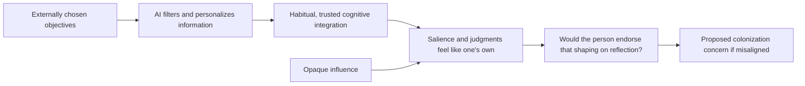

# Before You Think Guide

**An unofficial, credited reading companion to _Before You Think: System 0, AI-Mediated Cognition and Cognitive Colonization_.**

A guide for human readers and AI agents to the paper's arguments, distinctions, cited evidence, tables, and unresolved questions. This is a **conceptual and philosophical paper**, not a new experimental report. Its claims about cognitive architecture and cognitive colonization are proposals to examine, not established mechanisms demonstrated by a new dataset.

> Research credit: **Marianna Bergamaschi Ganapini, Massimo Chiriatti, Enrico Panai, and Giuseppe Riva**, in the paper's author order.
>
> arXiv:2606.13658v1 · submitted **11 June 2026** · **32 PDF pages** · [version studied](https://arxiv.org/abs/2606.13658v1) · [PDF](https://arxiv.org/pdf/2606.13658v1) · [canonical record](https://arxiv.org/abs/2606.13658) · [DOI](https://doi.org/10.48550/arXiv.2606.13658)
>
> Maintained by [0xHayd3n](https://github.com/0xHayd3n) with AI assistance. Unaffiliated with and not endorsed by the authors. No paper PDF, full text, original tables or figures, or author implementation is redistributed here. No experiments or replication were performed.

## The idea in one minute

An AI assistant can influence a decision before a person explicitly asks it for advice: it can choose what information appears, personalize the available options, and make some interpretations feel natural. The authors call this pre-reflective, personally integrated layer **System 0**. They argue that it can become part of how an individual thinks, rather than simply an outside source the individual consults. [§§2–2.2, pp. 2–7](https://arxiv.org/pdf/2606.13658v1#page=2)

Their further concern is **cognitive colonization**: an integrated layer may carry objectives originating outside the person, operate opaquely, and shape judgments in ways that the person would reject after reflection. Functional usefulness and deep integration need not guarantee alignment with the person's endorsed purposes. The paper explicitly describes this as a theoretical construct with a proposed diagnostic profile. [§§5–5.1, pp. 17–24](https://arxiv.org/pdf/2606.13658v1#page=17)

This original diagram summarizes the argument; it is not a measured causal model or a copy of a paper figure.



## Start reading

| Your goal | Module |
| --- | --- |
| Understand System 0 and its vocabulary | [Concepts and architecture](docs/01-concepts-and-architecture.md) |
| Follow the comparisons with System 3 and Thinkframes | [Three frameworks](docs/02-three-frameworks.md) |
| Audit every row of the cited evidence table | [Evidence and its limits](docs/03-evidence-and-its-limits.md) |
| Understand the proposed colonization diagnostic | [Cognitive colonization](docs/04-cognitive-colonization.md) |
| Examine objections, limitations, and practical implications | [Critical reading](docs/05-critical-reading.md) |
| Navigate every section, table, footnote, and reference page | [Complete paper map](docs/06-paper-map.md) |
| Discuss or design a future test of the ideas | [Questions and research agenda](docs/07-questions-and-research-agenda.md) |
| Work with an AI agent | [AGENTS.md](AGENTS.md), [LLMS.txt](LLMS.txt), [paper metadata](metadata/paper.json), [claim index](metadata/claims.json) |

A short route: this README → modules 1, 4, and 5.

A source-first route: read the versioned PDF alongside module 6; all page numbers here mean **one-based PDF pages**, which also match the printed page sequence in this attachment.

An evidence-audit route: module 3 → the corresponding passages in the paper → the original cited study. This guide's reading of a secondary description does not independently verify that study.

## What the paper contributes

| Contribution | Status and qualification | Source |
| --- | --- | --- |
| A three-level account of System 0: computational, psychological, and epistemic | Conceptual architecture; integration is described as gradual, and not all AI use qualifies | [§§2.1–2.3; Table 1, pp. 4–10](https://arxiv.org/pdf/2606.13658v1#page=4) |
| A comparison of System 0, Tri-System Theory, and Thinkframes | The authors' argumentative comparison, not a controlled comparison showing one theory wins | [§§3–4, pp. 10–17](https://arxiv.org/pdf/2606.13658v1#page=10) |
| A mapping from existing literature to candidate System 0 markers | Table 2 combines cited findings, interpretations, overlap, and an explicitly speculative example | [Table 2, pp. 16–17](https://arxiv.org/pdf/2606.13658v1#page=16) |
| Cognitive colonization as a diagnostic profile | Theoretical construct; the paper supplies no validated scale, prevalence estimate, or intervention trial | [§5; Table 3, pp. 17–22](https://arxiv.org/pdf/2606.13658v1#page=17) |
| A distinction between functional integration and normative alignment | Philosophical argument about agency and reflective endorsement | [§5.1, pp. 22–24](https://arxiv.org/pdf/2606.13658v1#page=22) |

There is deliberately **no experimental results dataset** in this repository. The structured claims distinguish conceptual claims, authors' interpretations of cited evidence, speculative examples, and normative arguments. No research experiments or replications were run.

## Key distinctions to preserve

- **Influence versus constitution:** changing what someone sees does not by itself show that a system is a component of their cognition.
- **Integration versus colonization:** routine reliance is insufficient; the proposed concern also involves external direction, opacity, and failure of reflective endorsement.
- **A finding versus an interpretation:** bias carryover or convergent writing can be a cited observation while its explanation in terms of System 0 remains contested.
- **System 0 versus all AI:** the paper describes a user-specific relationship and gradual integration, not a product category or a claim that every chatbot is part of a user's mind.
- **A proposed diagnostic versus a validated measure:** Table 3 gives criteria for investigation, not a calibrated test of individuals.

## Use with an agent

Read [AGENTS.md](AGENTS.md) before answering substantive questions. A useful prompt:

```text
Using docs/04-cognitive-colonization.md and the v1 paper,
explain how integration can be functionally successful yet normatively misaligned.
Cite PDF pages. Distinguish the authors' argument from third-party findings
and your own interpretation. Do not diagnose a person or product from this framework.
```

## Repository contents

```text
docs/01–07                       Original reading modules and complete source map
metadata/paper.json             Version, authors, paper type, license, provenance
metadata/claims.json            Typed, scoped claims and source page links
metadata/sources.json           Primary-source register and evidence-access limits
AGENTS.md / LLMS.txt             Agent grounding rules and navigation
CITATION.cff / references/paper.bib
ATTRIBUTION.md / LICENSE         Credits and licensing boundaries
CONTRIBUTING.md                  Correction and evidence guidelines
VERIFICATION.md                 Document integrity checks and their scope
scripts/validate_repository.py   Offline integrity checks
```

## Cite and credit

For the research, cite **Bergamaschi Ganapini, Chiriatti, Panai, and Riva (2026)**. Use [CITATION.cff](CITATION.cff) or [BibTeX](references/paper.bib). The arXiv record identifies the DOI above and links a **CC BY-NC-SA 4.0** paper license. This companion uses the same license conservatively; see [ATTRIBUTION.md](ATTRIBUTION.md) and [LICENSE](LICENSE). The companion's original explanations and condensed tables are changes from the source, not author-approved text.

## Provenance and maintenance

The exact uploaded `2606.13658v1.pdf` was read completely through Library's page-labeled text extraction, including all 32 pages. Binary materialization encountered the Windows `os.setxattr` limitation, so no attachment hash or byte-for-byte comparison is claimed. The official arXiv v1 record was checked separately for bibliographic and license metadata on **20 October 2026**. Content was not substituted with a different paper version. An auxiliary official arXiv v1 PDF was downloaded to visually inspect all three tables across pages 9–10, 16–17, and 21–22. Its 282,234-byte size matches the Library attachment metadata, but attachment binary equality remains unverified. [Provenance](metadata/paper.json)

Run `python scripts/validate_repository.py` for local structure, links, and metadata checks. These checks do not establish the truth of philosophical claims or validate the cited studies. [Verification scope](VERIFICATION.md)

